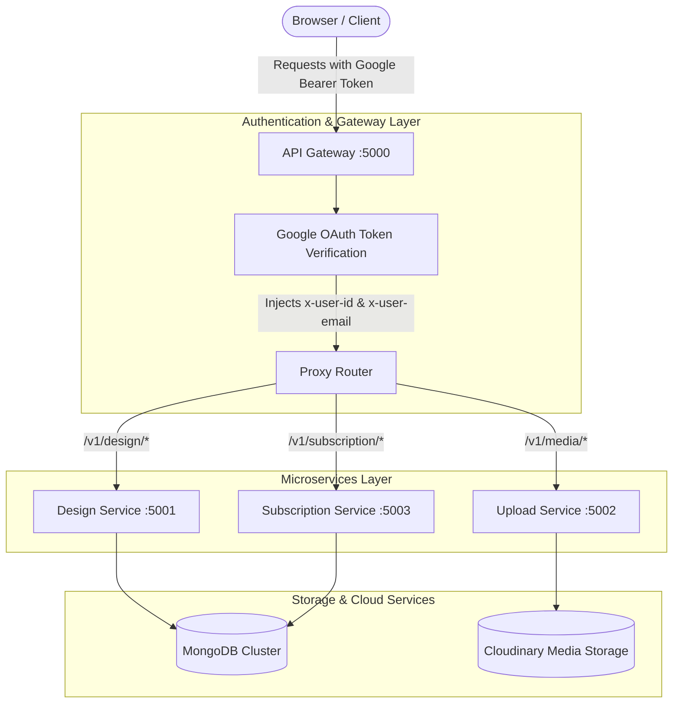

# 🎨 Canva Clone - Full-Stack Microservices Design Platform

An end-to-end, modern graphic design platform inspired by **Canva**, built with a **Next.js 15** frontend and a scalable **Node.js / Express microservices backend** powered by an **API Gateway**, **MongoDB**, and **Fabric.js**.

---

## 📑 Table of Contents

- [Overview](#-overview)
- [Architecture](#-architecture)
- [Key Features](#-key-features)
- [Tech Stack](#-tech-stack)
- [Repository Structure](#-repository-structure)
- [Prerequisites](#-prerequisites)
- [Environment Variables](#-environment-variables)
- [Getting Started](#-getting-started)
  - [1. Clone Repository](#1-clone-repository)
  - [2. Start Backend Microservices](#2-start-backend-microservices)
  - [3. Start Frontend Client](#3-start-frontend-client)
- [API Gateway Routing](#-api-gateway-routing)
- [Contributing](#-contributing)
- [License](#-license)

---

## 🌟 Overview

This project is a full-featured graphic design platform that replicates Canva's core studio and dashboard workflow. Users can choose pre-configured design templates (e.g., YouTube thumbnails, social media posts, logos), interact with a canvas studio via Fabric.js, customize typography, shapes, and colors, upload custom media, and manage their saved designs with persistent cloud storage.

---

## 🏗️ Architecture

The backend implements a **Microservices Architecture** orchestrated through a reverse-proxy **API Gateway**, ensuring separation of concerns, independent service scalability, and centralized authentication.



---

## ✨ Key Features

### 🖌️ Interactive Canvas Studio (Fabric.js)

- **Design Presets**: Instant dimension presets for YouTube Thumbnails (`900x500`), Logo Design (`400x465`), Social Media (`825x465`), Color Palettes (`500x500`), Typography (`200x200`), Printables (`600x600`), and Custom dimensions.
- **Canvas Manipulation**: Freehand drawing tools with adjustable brush sizes, color palettes, object selection, scaling, rotation, and alignment.
- **Rich Typography**: Configurable font families, headings, subheadings, and body text styles.
- **Exporting Options**: Download canvas creations directly as PNG, JPG, or PDF formats using `jsPDF` and `file-saver`.

### 🤖 AI-Powered Design Assistance

- **AI Thumbnail Generator**: Smart generator prompts for YouTube video thumbnails.
- **AI Backgrounds & Asset Generation**: Integrated AI tools to accelerate design composition.

### 🔐 Centralized Authentication

- **NextAuth v5 (Beta)**: Seamless Google OAuth login on the Next.js frontend.
- **Zero-Trust Token Propagation**: The API Gateway validates Google ID tokens and propagates user identity headers (`x-user-id`, `x-user-email`, `x-user-name`) downstream to internal services.

### 📂 Asset & Media Management

- Upload custom stickers, logos, and images to Cloudinary with persistent media references in MongoDB.

---

## 💻 Tech Stack

### Frontend (`/client`)

- **Framework**: [Next.js 15 (App Router)](https://nextjs.org/) + [React 19](https://react.dev/)
- **Styling**: [Tailwind CSS v4](https://tailwindcss.com/)
- **UI Components**: [Radix UI / Shadcn UI](https://ui.shadcn.com/), [Lucide React](https://lucide.dev/)
- **Canvas Engine**: [Fabric.js v7](https://fabricjs.com/)
- **Authentication**: [NextAuth.js v5](https://authjs.dev/)
- **State Management**: [Zustand](https://github.com/pmndrs/zustand)
- **Export Utilities**: `jspdf`, `file-saver`

### Backend Services (`/server`)

- **Runtime**: [Node.js](https://nodejs.org/) with [Express 5](https://expressjs.com/)
- **Database**: [MongoDB](https://www.mongodb.com/) via [Mongoose](https://mongoosejs.com/)
- **Gateway & Proxying**: `express-http-proxy`, `cors`, `helmet`
- **Security & Verification**: `google-auth-library`, `jsonwebtoken`
- **File Handling**: `multer`, `cloudinary`

---

## 📁 Repository Structure

```text
├── client/                     # Next.js 15 Frontend
│   ├── src/
│   │   ├── app/                # App Router (pages: /, /editor/[slug], /login)
│   │   ├── auth/               # NextAuth setup and configuration
│   │   ├── components/         # Reusable UI, banner, sidebar, header components
│   │   ├── config/             # Preset sizes, colors, fonts, and brush options
│   │   ├── fabric/             # Fabric.js canvas wrappers and event listeners
│   │   └── lib/                # Utility helpers
│   ├── package.json
│   └── .env
│
└── server/                     # Backend Microservices
    ├── api-gateway/            # Port 5000: Gateway, auth verification & routing
    │   └── src/
    │       ├── middleware/     # Google OAuth ID token verification
    │       └── server.js
    ├── design-service/         # Port 5001: Canvas persistence & CRUD
    │   └── src/
    │       ├── controllers/
    │       ├── models/
    │       └── server.js
    ├── upload-service/         # Port 5002: Asset & file uploads (Cloudinary)
    │   └── src/
    │       ├── controllers/
    │       ├── models/
    │       └── server.js
    └── subscription-service/   # Port 5003: User billing & subscription plans
        └── src/
            ├── controllers/
            ├── models/
            └── server.js
```

---

## ⚙️ Prerequisites

Before running the application, ensure you have:

- **Node.js** (v18.x or v20.x+)
- **npm** or **pnpm** or **yarn**
- A **MongoDB Atlas** database cluster (or local MongoDB running)
- A **Google Cloud Console Project** with OAuth 2.0 Web Client credentials
- A **Cloudinary Account** for media storage

---

## 🔐 Environment Variables

Create `.env` files in each relevant folder based on the templates below:

### 1. `client/.env`

```env
AUTH_SECRET=your_auth_secret_key
AUTH_GOOGLE_ID=your_google_oauth_client_id.apps.googleusercontent.com
AUTH_GOOGLE_SECRET=your_google_oauth_client_secret
```

### 2. `server/api-gateway/.env`

```env
PORT=5000
DESIGN=http://localhost:5001
UPLOAD=http://localhost:5002
SUBSCRIPTION=http://localhost:5003
GOOGLE_CLIENT_ID=your_google_oauth_client_id.apps.googleusercontent.com
```

### 3. `server/design-service/.env`

```env
PORT=5001
MONGO_URI=mongodb+srv://<username>:<password>@cluster0.mongodb.net/canva_design_db
```

### 4. `server/upload-service/.env`

```env
PORT=5002
MONGO_URI=mongodb+srv://<username>:<password>@cluster0.mongodb.net/canva_upload_db
CLOUDINARY_CLOUD_NAME=your_cloud_name
CLOUDINARY_API_KEY=your_api_key
CLOUDINARY_API_SECRET=your_api_secret
```

### 5. `server/subscription-service/.env`

```env
PORT=5003
MONGO_URI=mongodb+srv://<username>:<password>@cluster0.mongodb.net/canva_subscription_db
```

---

## 🚀 Getting Started

### 1. Clone Repository

```bash
git clone https://github.com/<your-username>/<your-repo-name>.git
cd <your-repo-name>
```

### 2. Start Backend Microservices

Install dependencies and start each microservice. For development, you can open separate terminal tabs:

#### API Gateway:

```bash
cd server/api-gateway
npm install
npm run dev
```

#### Design Service:

```bash
cd server/design-service
npm install
npm run dev
```

#### Upload Service:

```bash
cd server/upload-service
npm install
npm run dev
```

#### Subscription Service:

```bash
cd server/subscription-service
npm install
npm run dev
```

### 3. Start Frontend Client

```bash
cd client
npm install
npm run dev
```

Open [http://localhost:3000](http://localhost:3000) in your browser to access the application.

---

## 🌐 API Gateway Routing

All client communication passes through the API Gateway on `http://localhost:5000` with an `Authorization: Bearer <Google_ID_Token>` header:

| Gateway Route        | Target Service                 | Downstream Base | Purpose                                              |
| :------------------- | :----------------------------- | :-------------- | :--------------------------------------------------- |
| `/v1/design/*`       | Design Service (`:5001`)       | `/api/*`        | Create, list, fetch, edit, and delete canvas designs |
| `/v1/media/*`        | Upload Service (`:5002`)       | `/api/*`        | Upload and retrieve images & media assets            |
| `/v1/subscription/*` | Subscription Service (`:5003`) | `/api/*`        | Manage subscriptions, tiers, and user billing        |

---

## 🤝 Contributing

Contributions, issues, and feature requests are welcome!

1. Fork the Project
2. Create your Feature Branch (`git checkout -b feature/AmazingFeature`)
3. Commit your Changes (`git commit -m 'Add some AmazingFeature'`)
4. Push to the Branch (`git push origin feature/AmazingFeature`)
5. Open a Pull Request

---

## 📄 License

This project is licensed under the ISC License.
