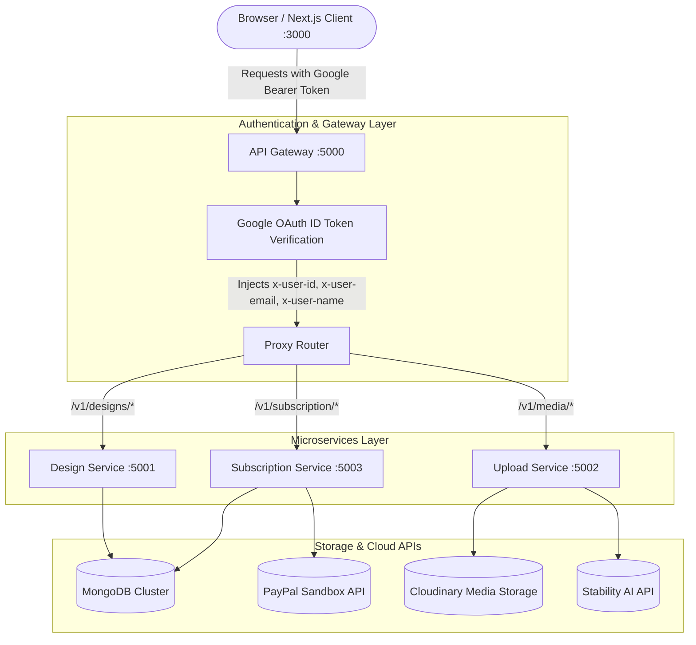

# 🎨 Canva Clone - Full-Stack Microservices Design Platform

An end-to-end, modern graphic design platform inspired by **Canva**, built with a **Next.js 15** frontend and a scalable **Node.js / Express microservices backend** orchestrated by an **API Gateway**, **MongoDB**, **PayPal Payments**, **Cloudinary / Stability AI**, and **Fabric.js**.

---

## 📑 Table of Contents

- [Overview](#-overview)
- [Architecture](#-architecture)
- [Key Features](#-key-features)
- [Tech Stack](#-tech-stack)
- [Repository Structure](#-repository-structure)
- [Prerequisites](#-prerequisites)
- [Environment Variables](#-environment-variables)
- [Getting Started](#-getting-started)
  - [1. Clone Repository](#1-clone-repository)
  - [2. Start Backend Microservices](#2-start-backend-microservices)
  - [3. Start Frontend Client](#3-start-frontend-client)
- [API Gateway Routing](#-api-gateway-routing)
- [Subscription & Billing (PayPal)](#-subscription--billing-paypal)
- [Trash & Recovery Workflow](#-trash--recovery-workflow)
- [Contributing](#-contributing)
- [License](#-license)

---

## 🌟 Overview

This platform provides a complete graphic design studio workflow replicating Canva's core features. Users can browse template categories, create and edit canvases, draw shapes, manipulate text and images, generate AI-powered backgrounds and thumbnail art, manage their design portfolio, move designs to trash with recovery support, and upgrade to Premium via PayPal Checkout.

---

## 🏗️ Architecture

The backend implements a **Microservices Architecture** unified behind an Express reverse-proxy **API Gateway**, ensuring isolated business domains, independent scalability, and secure centralized authentication.



---

## ✨ Key Features

### 🖌️ Interactive Canvas Studio (Fabric.js)

- **Presets & Custom Sizes**: Predefined dimensions for YouTube Thumbnails (`825x465`), Logo Design (`400x465`), Social Media, Color Palettes, Typography, and Printables.
- **Tools**: Freehand drawing brush, geometry shapes (rectangles, circles, triangles, stars), layer ordering (bring forward / send back), opacity, alignment, and flipping.
- **Rich Typography**: Add headings, subheadings, and body text with customizable font sizes, weights, alignments, and colors.
- **Smart Auto-Save**: Debounced auto-save with real-time status pill (`Saving...` / `Saved` / `Retry save`), guarded against race conditions to prevent overwriting existing designs.
- **Quick Home Navigation**: Integrated home icon button for instant return to the dashboard.
- **Exporting**: Download creations as **PNG**, **JPG**, or **PDF** (`jsPDF`).

### 🤖 AI Design Tools

- **AI Backgrounds & Images**: Text-to-image thumbnail creation powered by Stability AI.
- **Custom Uploads**: Upload user images and media to Cloudinary with drag-and-drop support.

### 🗑️ Trash & Recovery System

- **Confirmation Modals**: Prevents accidental deletions with a "Move to Trash?" dialog.
- **Soft Delete**: Trashed items are archived with a `deletedAt` timestamp instead of immediate hard-deletion.
- **Dedicated Trash Panel**: Accessible at the bottom of the sidebar.
- **One-Click Recovery**: Restore deleted designs back to active projects with updated timestamps.
- **Permanent Deletion**: Option to permanently erase items from the database when desired.

### 📁 Projects & Dashboard

- **Recent Designs**: Displays visual previews rendered from stored Fabric JSON data.
- **All Projects Modal**: Opens from the sidebar "Projects" tab to browse, search, and manage all your designs.

### 💳 PayPal Premium Subscriptions

- **Tiers**: Free plan (up to 5 designs) and Premium unlimited tier.
- **PayPal Sandbox Checkout**: Creates orders via PayPal Orders v2 API and captures completed payments securely on the backend.
- **Automatic Role Upgrade**: Instant activation of `isPremium` status in MongoDB upon payment confirmation.

### 🔐 Centralized Authentication

- **NextAuth.js v5**: Google OAuth authentication with JWT sessions.
- **Zero-Trust Token Forwarding**: The API Gateway validates tokens and passes sanitized user headers downstream.

---

## 💻 Tech Stack

### Frontend (`/client`)

- **Framework**: [Next.js 15 (App Router)](https://nextjs.org/) + [React 19](https://react.dev/)
- **Styling**: [Tailwind CSS v4](https://tailwindcss.com/)
- **UI Components**: [Shadcn UI](https://ui.shadcn.com/), [Lucide React](https://lucide.dev/), [Sonner (Toasts)](https://sonner.emilkowal.ski/)
- **Canvas Engine**: [Fabric.js v5](https://fabricjs.com/)
- **Authentication**: [NextAuth.js v5 Beta](https://authjs.dev/)
- **State Management**: [Zustand](https://github.com/pmndrs/zustand)
- **Export Utilities**: `jspdf`, `file-saver`

### Backend Services (`/server`)

- **Runtime**: [Node.js](https://nodejs.org/) with [Express 5](https://expressjs.com/)
- **Database**: [MongoDB](https://www.mongodb.com/) via [Mongoose](https://mongoosejs.com/)
- **Gateway & Proxying**: `express-http-proxy`, `cors`, `helmet`
- **Security & Auth**: `google-auth-library`, `jsonwebtoken`
- **Media & AI**: `multer`, `cloudinary`, `axios`
- **Payments**: `PayPal REST SDK / Orders v2 API`

---

## 📁 Repository Structure

```text
├── client/                     # Next.js 15 Frontend
│   ├── src/
│   │   ├── app/                # App Router (pages: /, /editor/[slug], /login, /subscription/success, /subscription/cancel)
│   │   ├── auth/               # NextAuth setup and auto-refresh configuration
│   │   ├── components/
│   │   │   ├── editor/         # Canvas Editor (canvas, header, sidebar, properties, export)
│   │   │   ├── home/           # Dashboard (banner, recent-designs, design-list, designs-modal, trash-modal, sidebar)
│   │   │   ├── subscription/   # Premium upgrade modal
│   │   │   └── ui/             # Reusable UI primitives (dialog, button, input, avatar, etc.)
│   │   ├── config/             # Preset sizes, colors, fonts, and brush options
│   │   ├── fabric/             # Fabric.js helpers and bounding box customizer
│   │   ├── services/           # API services (base-service, design-service, subscription-service)
│   │   └── store/              # Zustand editor and design store
│   ├── package.json
│   └── .env
│
└── server/                     # Backend Microservices
    ├── api-gateway/            # Port 5000: Gateway, auth verification & reverse proxy
    │   └── src/
    │       ├── middleware/     # Google OAuth ID token verification
    │       └── server.js
    ├── design-service/         # Port 5001: Canvas persistence, CRUD, trash & recovery
    │   └── src/
    │       ├── controllers/    # Design & trash controller
    │       ├── models/         # Design schema (with soft-delete support)
    │       ├── routes/
    │       └── server.js
    ├── upload-service/         # Port 5002: Cloudinary uploads & Stability AI image generation
    │   └── src/
    │       ├── controllers/
    │       ├── models/
    │       └── server.js
    └── subscription-service/   # Port 5003: User billing & PayPal Orders v2 integration
        └── src/
            ├── controllers/    # Payment & subscription controller
            ├── models/         # Subscription schema
            ├── routes/
            └── server.js
```

---

## ⚙️ Prerequisites

Before running the application, make sure you have:

- **Node.js** (v18.x or v20.x+)
- **npm** or **pnpm**
- A **MongoDB Atlas** cluster (or local MongoDB)
- A **Google Cloud Console Project** with OAuth 2.0 Web Client credentials
- A **PayPal Developer Account** with a Sandbox App (Client ID & Secret)
- A **Cloudinary Account** for asset storage
- _(Optional)_ A **Stability AI API Key** for text-to-image features

---

## 🔐 Environment Variables

Create `.env` files in each service directory based on the templates below:

### 1. `client/.env`

```env
AUTH_SECRET=your_auth_secret_key
AUTH_GOOGLE_ID=your_google_client_id.apps.googleusercontent.com
AUTH_GOOGLE_SECRET=your_google_client_secret
NEXT_PUBLIC_API_URL=http://localhost:5000
```

### 2. `server/api-gateway/.env`

```env
PORT=5000
DESIGN=http://localhost:5001
UPLOAD=http://localhost:5002
SUBSCRIPTION=http://localhost:5003
GOOGLE_CLIENT_ID=your_google_client_id.apps.googleusercontent.com
```

### 3. `server/design-service/.env`

```env
PORT=5001
MONGO_URI=mongodb+srv://<username>:<password>@cluster0.mongodb.net/canva_design_db
```

### 4. `server/upload-service/.env`

```env
PORT=5002
MONGO_URI=mongodb+srv://<username>:<password>@cluster0.mongodb.net/canva_upload_db
CLOUDINARY_CLOUD_NAME=your_cloud_name
CLOUDINARY_API_KEY=your_cloudinary_key
CLOUDINARY_API_SECRET=your_cloudinary_secret
STABILITY_API_KEY=your_stability_ai_key
```

### 5. `server/subscription-service/.env`

```env
PORT=5003
MONGO_URI=mongodb+srv://<username>:<password>@cluster0.mongodb.net/canva_subscription_db
PAYPAL_CLIENT_ID=your_paypal_sandbox_client_id
PAYPAL_CLIENT_SECRET=your_paypal_sandbox_secret
FRONTEND_URL=http://localhost:3000
```

---

## 🚀 Getting Started

### 1. Clone Repository

```bash
git clone https://github.com/<your-username>/<your-repo-name>.git
cd <your-repo-name>
```

### 2. Start Backend Microservices

Open separate terminals for each service:

```bash
# Terminal 1: API Gateway
cd server/api-gateway
npm install
npm run dev

# Terminal 2: Design Service
cd server/design-service
npm install
npm run dev

# Terminal 3: Upload Service
cd server/upload-service
npm install
npm run dev

# Terminal 4: Subscription Service
cd server/subscription-service
npm install
npm run dev
```

### 3. Start Frontend Client

```bash
# Terminal 5: Next.js Frontend
cd client
npm install
npm run dev
```

Open [http://localhost:3000](http://localhost:3000) to view the application.

---

## 🌐 API Gateway Routing

All client communication passes through the API Gateway at `http://localhost:5000` with the `Authorization: Bearer <Google_ID_Token>` header:

| Gateway Route                    | Target Service                 | Downstream Path                   | Method          | Purpose                                 |
| :------------------------------- | :----------------------------- | :-------------------------------- | :-------------- | :-------------------------------------- |
| `/v1/designs`                    | Design Service (`:5001`)       | `/api/designs`                    | `GET`, `POST`   | List active designs / Save canvas       |
| `/v1/designs/trash`              | Design Service (`:5001`)       | `/api/designs/trash`              | `GET`           | List soft-deleted designs in trash      |
| `/v1/designs/:id`                | Design Service (`:5001`)       | `/api/designs/:id`                | `GET`, `DELETE` | Fetch design by ID / Move to trash      |
| `/v1/designs/:id/recover`        | Design Service (`:5001`)       | `/api/designs/:id/recover`        | `PATCH`         | Restore a design from trash             |
| `/v1/designs/:id/permanent`      | Design Service (`:5001`)       | `/api/designs/:id/permanent`      | `DELETE`        | Permanently delete a design from DB     |
| `/v1/media/*`                    | Upload Service (`:5002`)       | `/api/media/*`                    | `GET`, `POST`   | Cloudinary asset upload & AI generation |
| `/v1/subscription`               | Subscription Service (`:5003`) | `/api/subscription`               | `GET`           | Fetch user subscription status          |
| `/v1/subscription/create-order`  | Subscription Service (`:5003`) | `/api/subscription/create-order`  | `POST`          | Create PayPal checkout order            |
| `/v1/subscription/capture-order` | Subscription Service (`:5003`) | `/api/subscription/capture-order` | `POST`          | Capture PayPal payment & activate plan  |

---

## 💳 Subscription & Billing (PayPal)

- **Sandbox Buyer Account**: When testing payments, use the Sandbox Personal Buyer credentials from the [PayPal Developer Dashboard](https://developer.paypal.com/) (`Testing Tools > Sandbox Accounts`) to approve payments.
- **Credit Card Testing**: If paying by card in Sandbox, ensure **Country/Region** is set to `United States` with any valid US postal code (e.g. `90210`) to match PayPal's test credit card BINs.

---

## 🗑️ Trash & Recovery Workflow

1. Click the **Trash icon** on any design card in the dashboard.
2. Confirm the **"Move to Trash?"** dialog. The item is soft-deleted (`deletedAt != null`) and removed from active lists.
3. Click the **Trash** tab at the bottom of the sidebar to view all trashed designs.
4. From the Trash Modal:
   - Click **Recover** to restore the design immediately.
   - Click **Delete Forever** to permanently delete it from MongoDB.

---

## 🤝 Contributing

1. Fork the Project
2. Create your Feature Branch (`git checkout -b feature/NewFeature`)
3. Commit your Changes (`git commit -m 'Add NewFeature'`)
4. Push to the Branch (`git push origin feature/NewFeature`)
5. Open a Pull Request

---

## 📄 License

This project is licensed under the ISC License.
